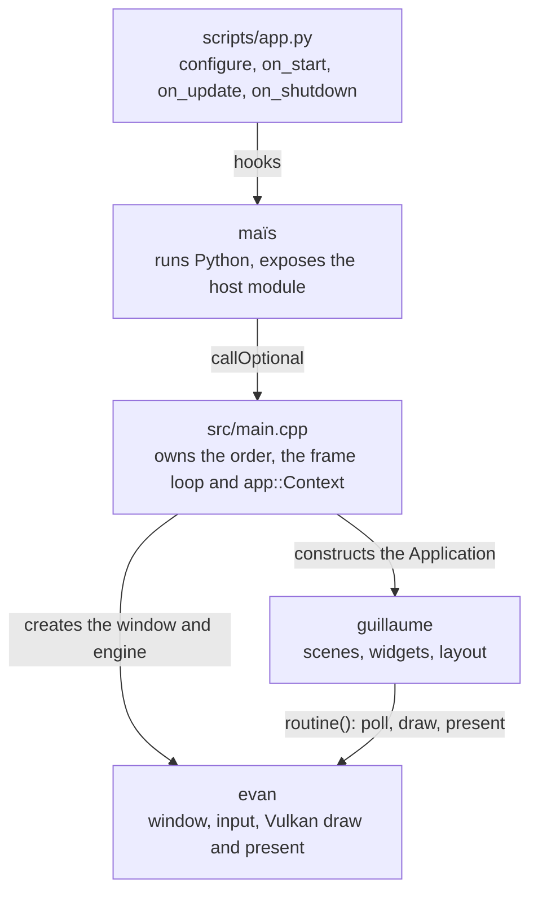

# The libraries behind the application

The application is assembled from three XIDER libraries. None of them knows
about the others: `src/main.cpp` is the only place where they meet, and it
decides the order in which they are started, called and stopped.

| Library | What it does | Read more |
| --- | --- | --- |
| [evan](https://github.com/etib-corp/evan) | Opens the window and renders with Vulkan, through its GLFW desktop backend. | [evan.md](evan.md) |
| [guillaume](https://github.com/etib-corp/guillaume) | UI framework: application shell, scenes, widgets, layout, events, theme and storage. | [guillaume.md](guillaume.md) |
| [maïs](https://github.com/etib-corp/mais) | Embedded Python runtime: interpreter lifecycle, script loading, hooks and host bindings. | [mais.md](mais.md) |

Each page covers the same ground: what the library does on its own, what it
deliberately leaves to the others, which parts this application uses, and
where they appear in `src/`.

## How they fit together

The libraries are stacked, not coupled: maïs hands the script plain values,
guillaume calls the engine it was given, and evan knows nothing about either.
`src/main.cpp` fills the gaps between them.

## A session, in order

1. maïs starts Python, the `host` module is registered and `scripts/app.py`
   is loaded.
2. The script proposes the window settings in `configure`.
3. The host validates the proposal, then evan creates the window and the
   engine.
4. guillaume enters `HomeScene` and the script receives `on_start`.
5. Each frame: the script runs `on_update`, guillaume runs one frame through
   evan, and the host shows the text the script wrote.
6. The script receives `on_shutdown` at the end of the session. The window
   and the scenes are destroyed when the host leaves its loop, and Python
   stops last.

The full walkthrough is in the
[top-level README](../README.md#how-a-session-runs).

## Reading order

Start with [evan.md](evan.md) for the bottom layer, then
[guillaume.md](guillaume.md) for the scenes and widgets, then
[mais.md](mais.md) for the script.

[windows.md](windows.md) is the odd one out: it is not about a library, it
lists what to install on a Windows computer and how the build adapts to it.
